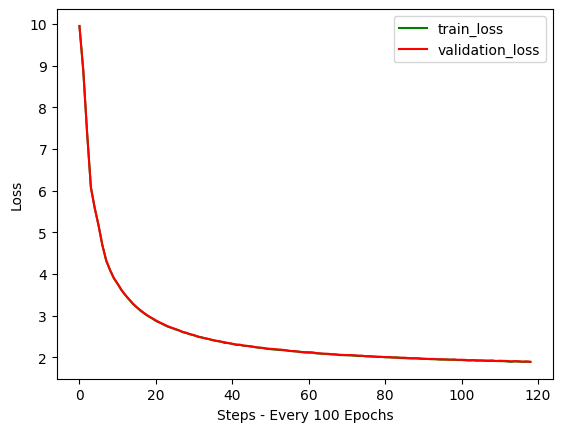

# SLM — A Small Language Model Built From Scratch

A ~30M-parameter GPT-style language model implemented from scratch in PyTorch and pre-trained on the [TinyStories](https://huggingface.co/datasets/roneneldan/TinyStories) dataset. The project walks through the full pipeline end to end: tokenization, memory-mapped data loading, the transformer architecture, a training loop with gradient accumulation, and text generation.

Trained on a single NVIDIA Tesla V100 (32 GB) on Wake Forest University's DEAC HPC cluster.

---

## Sample Output

**Prompt:**
> The pig once looked at the moon and thought happy dreams. To his surprise

**Generated (200 new tokens, temperature 1.0):**
> The pig once looked at the moon and thought happy dreams. To his surprise, he decided to climb the moon every day to see how high the moon twinkled and shone brightly.
>
> The little pig kept climbing until his dream came true. He was so excited he search everywhere, until he saw it again. He couldn't believe how pretty the moon had matched - it had sparkly stars and the night before!
>
> The little pig couldn't wait to tell his mom all of his special night. ...

The model produces grammatical, story-shaped text with consistent characters over short spans. Over longer generations it drifts (characters and plot change abruptly), which is expected given the 128-token context window.

---

## Results

| Metric | Value |
|---|---|
| Initial validation loss | 9.95 |
| Best validation loss | **1.890** (step 59,500) |
| Validation perplexity | ~6.6 |
| Final train / val gap | < 0.01 |



Train and validation loss track each other almost exactly for the full run, so the model is not overfitting. Loss was still declining slowly at the end of training, which suggests more training would continue to help.

---

## Architecture

A decoder-only transformer in the GPT-2 style, written from the module level up (no `transformers` library).

| Hyperparameter | Value |
|---|---|
| Parameters | ~30.0M (~10.6M excluding embeddings) |
| Transformer blocks (`n_layer`) | 6 |
| Attention heads (`n_head`) | 6 |
| Embedding dimension (`n_embd`) | 384 |
| Context length (`block_size`) | 128 tokens |
| Vocabulary | 50,257 (GPT-2 BPE via `tiktoken`) |
| Dropout | 0.1 |

**Components implemented:**
- **Token + learned positional embeddings**, with the input embedding weights tied to the output head
- **Causal multi-head self-attention** — uses PyTorch's fused `scaled_dot_product_attention` when available, with a manual masked-softmax fallback
- **Pre-LayerNorm transformer blocks** with residual connections
- **Feed-forward MLP** with a 4× expansion and GELU activation
- **Scaled weight initialization** for residual projections (scaled by depth)
- **Autoregressive generation** with temperature and optional top-k sampling

---

## Training Pipeline

### 1. Data
- **Dataset:** TinyStories — ~2.1M short stories written in simple vocabulary (21,990 held out for validation)
- **Tokenization:** GPT-2 byte-pair encoding (`tiktoken`), parallelized across 8 processes
- **Storage:** All token IDs are written to `train.bin` / `validation.bin` as `uint16` memory-mapped arrays, so the dataset is read from disk on demand instead of held in RAM

### 2. Batching
Random 128-token windows are sampled from the memory-mapped files. Targets are the inputs shifted right by one token (next-token prediction). On GPU, batches are pinned and transferred asynchronously.

### 3. Optimization

| Setting | Value |
|---|---|
| Optimizer | AdamW (β₁ = 0.9, β₂ = 0.95, weight decay = 0.1) |
| Peak learning rate | 5e-4 |
| Schedule | Linear warmup over 100 optimizer steps, then held near the 5e-4 peak (see Next Steps) |
| Micro-batch | 32 sequences × 128 tokens |
| Gradient accumulation | 32 micro-batches per optimizer step |
| Training iterations | 60,000 micro-batches (1,875 optimizer steps) |
| Tokens processed | ~246M |
| Gradient clipping | max norm 0.5 |
| Precision | FP32 (an autocast + `GradScaler` mixed-precision path is wired in; see Next Steps) |

Validation loss is estimated every 500 iterations over 500 batches, and the checkpoint with the lowest validation loss is saved to `best_model_params.pt`.

### Tuning notes
An earlier run showed overfitting. The changes that produced the final run:
- Increased context length 64 → 128 to capture longer-range dependencies
- Increased micro-batch size 16 → 32 for a better gradient estimate
- Tripled training length (20,000 → 60,000 iterations)
- Shortened warmup (1,000 → 100 steps) and added weight decay

---

## Repository Structure

```
SLM/
└── SLM_Demo.ipynb   # Full pipeline: data → tokenization → model → training → loss plot → inference
```

---

## Getting Started

### Requirements
- Python 3.11
- A CUDA GPU is strongly recommended (training was done on a V100; CPU will be very slow)

```bash
pip install torch tiktoken datasets numpy tqdm matplotlib
```

### Running
1. Clone the repo and open `SLM_Demo.ipynb` in Jupyter.
2. The notebook pins a specific GPU with `os.environ["CUDA_VISIBLE_DEVICES"] = "3"` (needed on the shared cluster). Change or remove this line for your machine.
3. Run the cells top to bottom. The first run downloads TinyStories (~1 GB) and writes `train.bin` / `validation.bin`; later runs skip this step.
4. Training saves the best checkpoint to `best_model_params.pt`. Model weights are not included in this repo, so you need to train once before running inference.

**Inference only (after a checkpoint exists):** run the setup, tokenization, model definition, model config, training config, and checkpoint-loading cells, then the generation cell. Edit `sentence` to try your own prompts.

---

## Limitations and Next Steps

- **Short context:** 128 tokens limits coherence across a full story. Extending context is the most direct path to better long-form output.
- **Narrow domain:** TinyStories uses a deliberately simple vocabulary, so the model does not generalize to adult or technical text.
- **Planned:**
  - Count the cosine LR schedule in optimizer steps so the learning rate actually decays over the run. Loss was still falling at the end, so this and longer training are the cheapest gains available.
  - Enable true FP16 mixed precision for faster training on the V100
  - Refactor the notebook into importable modules (`model.py`, `train.py`, `generate.py`)
  - Publish trained weights (e.g., to the Hugging Face Hub)
  - Experiment with longer context, larger models, and top-k / nucleus sampling
  - Fine-tune for an instruction-following or domain-specific task

---

## Acknowledgments

- Model architecture follows the GPT-2 design popularized by Andrej Karpathy's [nanoGPT](https://github.com/karpathy/nanoGPT).
- Dataset: Ronen Eldan and Yuanzhi Li, [*TinyStories: How Small Can Language Models Be and Still Speak Coherent English?*](https://arxiv.org/abs/2305.07759) (2023).
- Compute provided by the Wake Forest University DEAC HPC cluster.

---

**Author:** Jalen Marshall — [GitHub](https://github.com/iamjalenmarshall)
